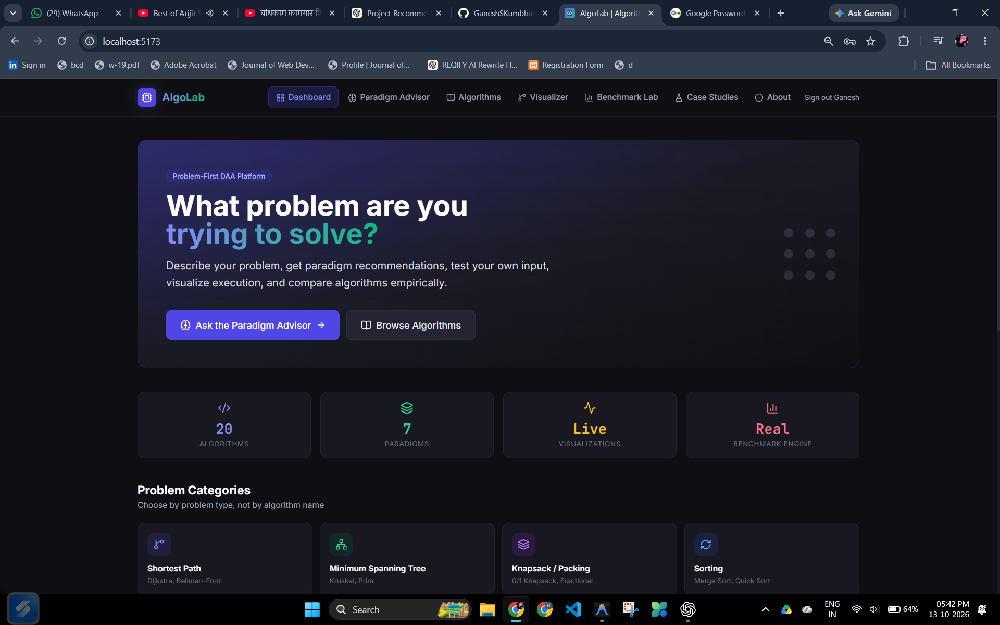
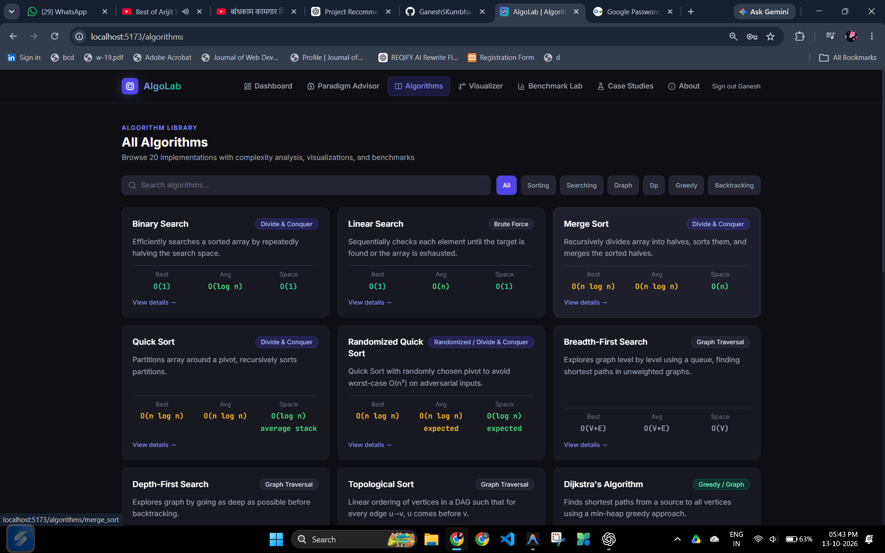
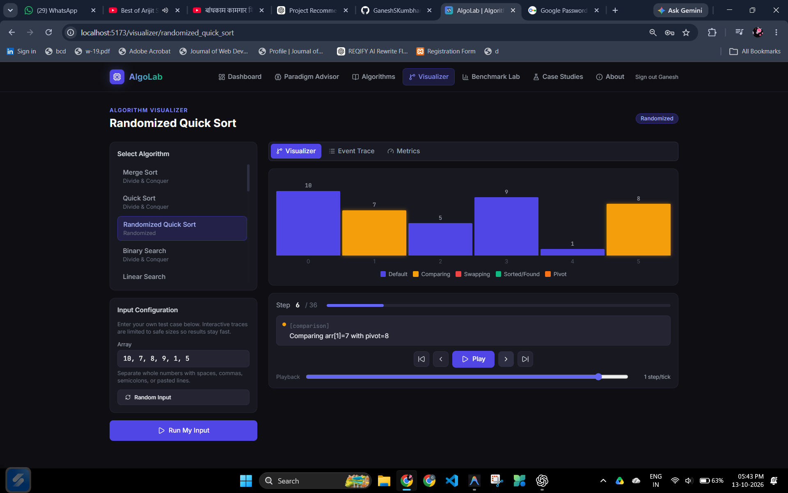
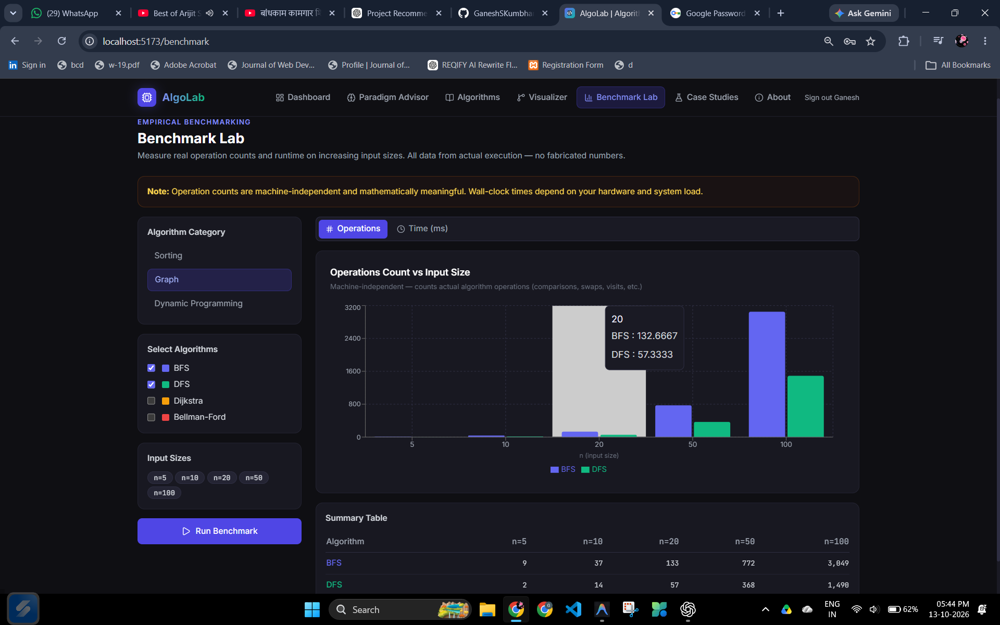
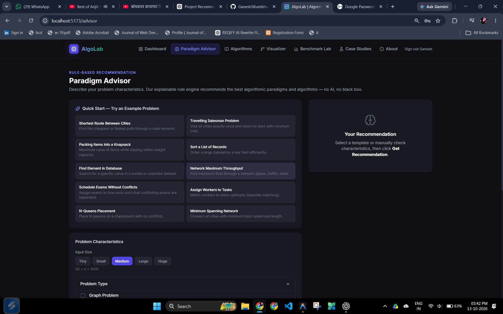
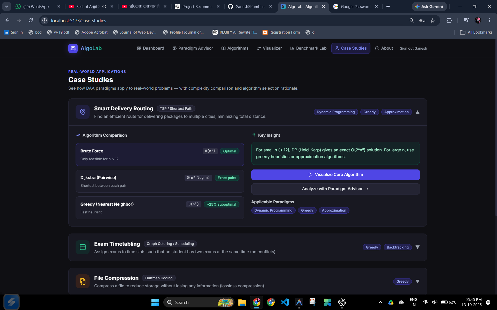
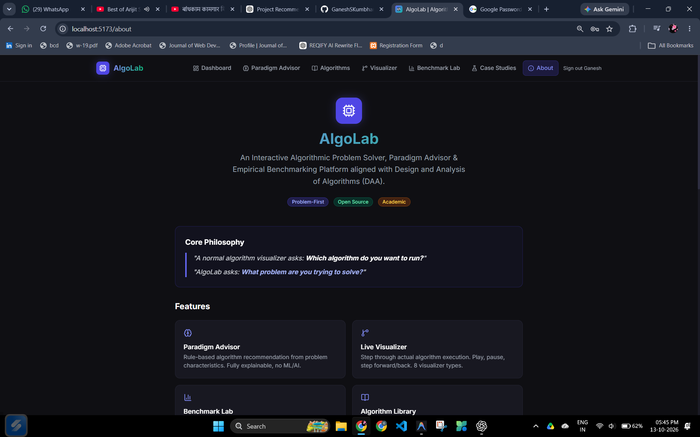
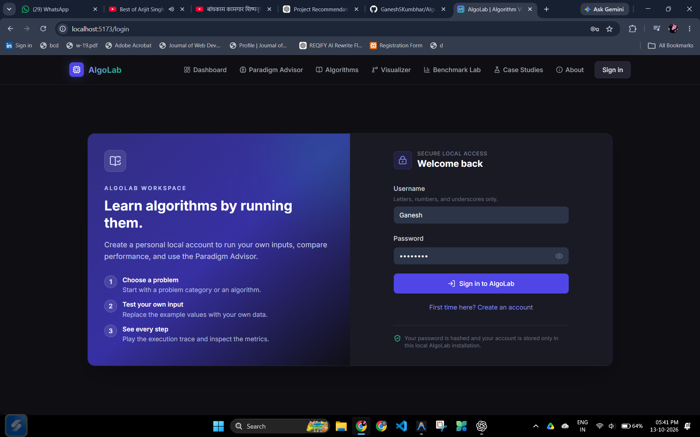

<div align="center">

# 🧪 AlgoLab

### 🚀 Interactive Design & Analysis of Algorithms Platform

_Visualise algorithms step by step 🎬 · Get explainable paradigm recommendations 🧭 · Benchmark performance against theory 📊_

<br/>


[](https://github.com/GaneshSKumbhar/AlgoLab/stargazers)
[](https://github.com/GaneshSKumbhar/AlgoLab/fork)
[](https://github.com/GaneshSKumbhar/AlgoLab/issues)

<br/>

[✨ Features](#-features) · [📸 Screenshots](#-screenshots) · [🏗️ Architecture](#️-architecture) · [📂 Structure](#-project-structure) · [🚀 Quick Start](#-quick-start) · [🧪 Testing](#-testing) · [🛠️ Troubleshooting](#️-troubleshooting) · [🤝 Contributing](#-contributing)

</div>

---

## 📑 Table of Contents

1. [📖 Overview](#-overview)
2. [🎯 Why AlgoLab?](#-why-algolab)
3. [✨ Features](#-features)
4. [📸 Screenshots](#-screenshots)
5. [🧱 Tech Stack](#-tech-stack)
6. [🏗️ Architecture](#️-architecture)
7. [🧭 How the Paradigm Advisor Works](#-how-the-paradigm-advisor-works)
8. [🧮 Algorithm Coverage](#-algorithm-coverage)
9. [📂 Project Structure](#-project-structure)
10. [🚀 Quick Start](#-quick-start)
11. [☁️ Free Deployment](#️-free-deployment)
12. [🧪 Testing](#-testing)
13. [🛠️ Troubleshooting](#️-troubleshooting)
14. [🎨 Design Notes](#-design-notes)
15. [🛣️ Roadmap](#️-roadmap)
16. [🤝 Contributing](#-contributing)
17. [👤 Author](#-author)
18. [📜 License](#-license)

---

## 📖 Overview

**AlgoLab** is a full-stack educational platform built for the _Design and Analysis of Algorithms_ course. Rather than teaching one algorithm at a time, AlgoLab starts from the **problem**: describe what you need to solve, and the platform recommends a suitable paradigm, runs candidate algorithms, animates their execution, and measures how they actually scale.

It answers the three questions every algorithms student faces:

| ❓ Question                                                                                                                      | 🛠️ AlgoLab feature         |
| -------------------------------------------------------------------------------------------------------------------------------- | -------------------------- |
| **Which paradigm fits this problem?** Divide and conquer, dynamic programming, greedy, backtracking, flow, or NP-hard territory? | 🧭 Paradigm Advisor        |
| **What is the algorithm actually doing?**                                                                                        | 🎬 Step-by-step Visualizer |
| **Does it scale the way theory says?**                                                                                           | 📊 Benchmark Lab           |

> 📄 The full project proposal and specification is included in the repo as [`AlgoLab_Project_Document.docx`](AlgoLab_Project_Document.docx).

---

## 🎯 Why AlgoLab?

- 🧠 **Problem-first learning**: choose a strategy for a _fresh_ problem, the core skill the course targets.
- 🔍 **Transparent**: the advisor is rule-based and explainable, with no black-box guessing.
- 🎬 **Honest visualisation**: the animation _is_ the real execution trace, not a mock-up.
- 📈 **Evidence-driven**: compare measured runtime and operation counts with theoretical bounds.
- 🌍 **Applied**: case studies link algorithms to realistic scenarios like routing and compression.

---

## ✨ Features

### 🧭 Paradigm Advisor

- Rule-based, fully **explainable** engine that recommends the most suitable algorithmic paradigm.
- Takes problem characteristics (structure, overlapping subproblems, greedy-choice property, constraints) and explains _why_ a paradigm fits.

### 🎬 Algorithm Visualizer

- Animated execution traces with **colour-coded highlights**.
- Live **metrics** (comparisons, swaps, steps) alongside the animation.
- ▶️ Play, ⏸️ pause, ⏭️ step controls for classroom-friendly walkthroughs.

### 📊 Benchmark Lab

- Run **bulk benchmarks** across input sizes and input types.
- Compare **runtime and operation counts** between algorithms.
- Inspect results in **sortable tables** and charts.

### 🌍 Case Studies

- Real-world walkthroughs: 🚚 routing, 🗓️ timetabling, 🗜️ compression, and more.
- Shows how several algorithms combine to solve one practical problem.

### 📚 Algorithm Library

- Browse every algorithm, **filter by category and paradigm**, and open a detail page for each.

### 🔐 Authentication

- Secure sign-in and sign-out powered by **JWT**.

### ⚡ Developer-Friendly API

- **FastAPI** backend with auto-generated, interactive **OpenAPI** docs at `/docs`.

### 🎨 Modern UI

- Responsive **glass-morphism** cards, smooth micro-animations, and **dark-mode ready** styling.
- ♿ Semantic HTML, ARIA labels and keyboard-friendly navigation.

---

## 📸 Screenshots

### 🏠 Dashboard


_Dashboard overview with algorithm categories and quick links._

### 📚 Algorithm Library


_Browse all algorithms, filter by category and paradigm._

### 🎬 Visualizer


_Step-by-step visualisation of an algorithm execution trace._

### 📊 Benchmark Lab


_Run benchmarks, view results in sortable tables and charts._

### 🧭 Paradigm Advisor


_Get explainable paradigm recommendations for a given problem._

### 🌍 Case Studies


_Interactive case-study walkthroughs for real-world scenarios._

### ℹ️ About


_About page describing the project and its goals._

### 🔐 Login


_Secure sign-in and account creation._

---

## 🧱 Tech Stack

| 🧩 Layer            | 🛠️ Technology                         |
| ------------------- | ------------------------------------- |
| 🎨 Frontend         | React, Vite, TypeScript, Tailwind CSS |
| ⚙️ Backend          | Python 3.10+, FastAPI, Uvicorn        |
| 🔐 Auth             | JWT (JSON Web Tokens)                 |
| 🧪 Testing          | pytest                                |
| 🧹 Linting          | Oxlint (TypeScript), flake8 (Python)  |
| 📦 Package managers | npm, pip                              |

---

## 🏗️ Architecture

```
┌────────────────────────────┐      HTTP / JSON       ┌────────────────────────────────┐
│  🎨 React + Vite Frontend   │ ─────────────────────► │  ⚙️ FastAPI Backend             │
│                            │                        │                                │
│  🏠 Dashboard               │                        │  🔐 auth/       JWT utilities   │
│  📚 Algorithms              │ ◄───────────────────── │  🧮 algorithms/ sorting·graph·dp│
│  🎬 Visualizer              │   traces · metrics ·   │  📊 benchmark/  runner + models │
│  📊 Benchmark Lab           │   recommendations      │  🧭 advisor/    paradigm rules  │
│  🧭 Paradigm Advisor        │                        │                                │
└────────────────────────────┘                        └────────────────────────────────┘
```

**💡 Core design principle:** every algorithm emits a uniform **execution trace** (comparisons, swaps, visits, relaxations, and so on). That one trace feeds three consumers:

1. 🎬 the **Visualizer** animation,
2. 📟 the live **metrics panel**,
3. 📊 the **Benchmark** counters.

What you see animated is exactly what was executed and measured.

---

## 🧭 How the Paradigm Advisor Works

The advisor walks a transparent decision tree, asking structural questions about the problem:

| 🤔 Question                                                                  | ✅ If yes                            | 📌 Typical algorithms                |
| ---------------------------------------------------------------------------- | ------------------------------------ | ------------------------------------ |
| Does the problem split into independent subproblems of the same type?        | 🔪 Divide and Conquer                | Merge sort, quick sort, closest pair |
| Do subproblems overlap, with optimal substructure?                           | 🧩 Dynamic Programming               | Knapsack, LCS, matrix chain          |
| Does a locally best choice lead to a global optimum?                         | 🎯 Greedy                            | MST, Dijkstra, Huffman coding        |
| Is it a constraint-satisfaction or search problem with early-failure checks? | 🔙 Backtracking                      | N-Queens, Sudoku, graph colouring    |
| Can it be modelled as flow on a capacitated graph?                           | 🌊 Network Flow                      | Matching, assignment                 |
| Is it known to be NP-hard?                                                   | 🧱 Exact + approximation / heuristic | TSP, vertex cover, clique            |

Every recommendation comes with a **plain-language explanation**, making it easy to defend in a viva. 🎓

---

## 🧮 Algorithm Coverage

| 📁 Package              | 🔧 Examples                          |
| ----------------------- | ------------------------------------ |
| 🔢 `algorithms/sorting` | Quick sort, merge sort, heap sort    |
| 🕸️ `algorithms/graph`   | BFS, DFS, Dijkstra, and more         |
| 🧩 `algorithms/dp`      | Knapsack, longest common subsequence |

> 🗺️ Additional modules (network flow, NP-completeness reductions, backtracking suites) are listed in the [Roadmap](#️-roadmap) and in the project document.

---

## 📂 Project Structure

### 🗂️ Root Directory

```
AlgoLab/
├── 📁 .git/                          # Git history (ignored in releases)
├── 📄 .gitignore                     # Files/folders excluded from version control
├── 📄 .oxlintrc.json                 # Oxlint configuration for TypeScript linting
├── 📘 AlgoLab_Project_Document.docx  # Detailed project proposal and specification
├── 📄 README.md                      # Project overview (you are reading it!)
├── 🖼️ image.png                      # Original screenshot
├── 📁 images/                        # 📸 Screenshots used in this README
│   ├── about.png
│   ├── algorithm.png
│   ├── benchmarks.png
│   ├── caseStudies.png
│   ├── dashboard.png
│   ├── login.png
│   ├── paradigm.png
│   └── visualizer.png
├── 📁 backend/                       # 🐍 Python FastAPI server
├── 📁 frontend/                      # ⚛️ React + Vite SPA
├── 📁 docs/                          # Additional documentation (could host MkDocs/Sphinx)
└── 📁 .docx-review/                  # Review artefacts for the .docx spec (optional)
```

### 🐍 Backend (`backend/`)

```
backend/
├── 📁 app/                           # Core application package
│   ├── 📄 __init__.py
│   ├── 📄 main.py                    # 🚪 FastAPI entry point (uvicorn runs this)
│   ├── 📁 auth/                      # 🔐 JWT authentication utilities
│   ├── 📁 algorithms/                # 🧮 Algorithm implementations
│   │   ├── 📁 sorting/               #    quicksort, mergesort, heap-sort
│   │   ├── 📁 graph/                 #    BFS, DFS, Dijkstra, etc.
│   │   └── 📁 dp/                    #    knapsack, longest common subsequence
│   ├── 📁 benchmark/                 # 📊 Benchmark runner and result models
│   └── 📁 advisor/                   # 🧭 Paradigm-recommendation engine
├── 📁 tests/                         # 🧪 pytest test suite
│   ├── 📄 test_sorting.py
│   ├── 📄 test_graph.py
│   └── …
├── 📄 requirements.txt               # Python dependencies
└── 📁 venv/                          # Virtual environment (gitignored)
```

### ⚛️ Frontend (`frontend/`)

```
frontend/
├── 📁 public/                        # Static assets served as-is
│   ├── 🎨 favicon.svg                # Custom gradient "A" favicon
│   └── 🎨 icons.svg
├── 📁 src/                           # Source code (TypeScript, JSX, CSS)
│   ├── 📁 assets/                    # Images imported directly in components
│   ├── 📁 components/                # ♻️ Reusable UI components (cards, badges, ...)
│   │   └── 📁 ui/                    #    Design-system primitives
│   ├── 📁 pages/                     # 📄 Page-level components (router targets)
│   │   ├── 📁 Algorithms/            #    📚 List and detail views
│   │   │   ├── 📄 Algorithms.tsx
│   │   │   └── 📄 AlgorithmDetail.tsx
│   │   ├── 📁 BenchmarkLab/          #    📊 Benchmark UI
│   │   ├── 📁 ParadigmAdvisor/       #    🧭 Advisor UI
│   │   └── 📁 Visualizer/            #    🎬 Visualisation UI
│   ├── 📁 services/                  # 🔌 API wrapper (src/services/api.ts)
│   ├── 📄 App.tsx                    # Root React component + router
│   ├── 📄 main.tsx                   # ReactDOM entry point
│   └── 📄 index.css                  # Global Tailwind imports + custom styles
├── 📄 .env.example                   # Template env file (VITE_API_URL etc.)
├── 📄 package.json                   # NPM dependencies and scripts
├── 📄 tailwind.config.js             # Tailwind configuration (dark mode, colours)
├── 📄 vite.config.ts                 # Vite configuration (React plugin)
└── 📄 tsconfig.json                  # TypeScript compiler options
```

---

## 🚀 Quick Start

### ✅ Prerequisites

| Tool       | Version                                 |
| ---------- | --------------------------------------- |
| 🟢 Node.js | 18 or later                             |
| 🐍 Python  | 3.10 or later                           |
| 🔧 Git     | any recent version                      |
| 💻 Shell   | PowerShell (Windows) or any POSIX shell |

### 1️⃣ Clone the repository

```bash
git clone https://github.com/GaneshSKumbhar/AlgoLab.git
cd AlgoLab
```

### 2️⃣ Start the backend (FastAPI) 🐍

**🪟 Windows (PowerShell)**

```powershell
cd backend
python -m venv venv
.\venv\Scripts\Activate.ps1
pip install -r requirements.txt
uvicorn app.main:app --reload --port 8000
```

**🍎🐧 macOS / Linux**

```bash
cd backend
python3 -m venv venv
source venv/bin/activate
pip install -r requirements.txt
uvicorn app.main:app --reload --port 8000
```

📖 Interactive API docs: <http://localhost:8000/docs>

### 3️⃣ Start the frontend (React + Vite) ⚛️

**🪟 Windows (PowerShell)**

```powershell
cd frontend
Copy-Item .env.example .env    # adjust VITE_API_URL if needed
npm install
npm run dev
```

**🍎🐧 macOS / Linux**

```bash
cd frontend
cp .env.example .env           # adjust VITE_API_URL if needed
npm install
npm run dev
```

🌐 Open <http://localhost:5173> in your browser.

### 🔑 Environment Variables

| Variable                 | 📍 Location     | 📝 Purpose                                      | 💡 Example                                      |
| ------------------------ | --------------- | ----------------------------------------------- | ----------------------------------------------- |
| `VITE_API_URL`           | `frontend/.env` | Base URL of the backend API during local work   | `http://localhost:8000`                         |
| `ALGOLAB_AUTH_SECRET`    | `backend/.env`  | Long random secret for signed login sessions    | generate a different random value for deployment |
| `DATABASE_URL`           | `backend/.env`  | Hosted PostgreSQL connection for deployed users | `postgresql://...?...sslmode=require`           |
| `FRONTEND_ORIGINS`       | `backend/.env`  | Comma-separated browser origins for split hosting | `https://example.com`                         |

### 🧰 Handy Commands

| Command                                     | 📁 Run in   | What it does                   |
| ------------------------------------------- | ----------- | ------------------------------ |
| `uvicorn app.main:app --reload --port 8000` | `backend/`  | Start API with hot reload      |
| `pytest -q`                                 | `backend/`  | Run backend tests quietly      |
| `npm run dev`                               | `frontend/` | Start the Vite dev server      |
| `npm run build`                             | `frontend/` | Production build               |
| `npm test`                                  | `frontend/` | Frontend tests (if configured) |

---

## ☁️ Free Deployment

The repository contains a production `Dockerfile` that builds the React interface and serves it from the same FastAPI service. This removes cross-origin API delays and means the public app uses one URL.

For a free public demo, use **Koyeb** for the web service and **Neon** for the PostgreSQL database:

1. Create a free Neon project, then copy its **pooled PostgreSQL connection string**. Keep `sslmode=require` in the URL.
2. In Koyeb, create a **Web Service** from `https://github.com/GaneshSKumbhar/AlgoLab`, choose the `main` branch, and select the repository `Dockerfile` builder.
3. Select the free Web Service size, expose port `8000` as HTTP on route `/`, and set the HTTP health-check path to `/health`.
4. Add these Koyeb **secret** environment variables (never commit them):

   ```text
   DATABASE_URL=<your Neon pooled PostgreSQL connection string>
   ALGOLAB_AUTH_SECRET=<a long, unique random value>
   ```

5. Deploy. Koyeb will build the image from GitHub. Open the generated `*.koyeb.app` URL and create the first AlgoLab account from the Sign in page.
6. To avoid the free Koyeb instance's one-hour idle sleep, create one free UptimeRobot HTTP monitor for `https://<your-app>.koyeb.app/health` with the five-minute interval.

The first database connection after Neon suspends its compute can take a little longer, but the dashboard itself stays on one origin and does not wait for a separate frontend service. Koyeb's free tier is suitable for coursework and demonstrations; use a paid always-on service for a production system with availability guarantees.

---

## 🧪 Testing

### 🐍 Backend

```powershell
cd backend
.\venv\Scripts\Activate.ps1      # macOS/Linux: source venv/bin/activate
pytest -q
```

### ⚛️ Frontend

```bash
cd frontend
npm test
```

### 🧹 Linting

```bash
# 🐍 Python
flake8 backend

# ⚛️ TypeScript (Oxlint, configured in .oxlintrc.json)
cd frontend && npm run lint
```

---

## 🛠️ Troubleshooting

| 🐞 Problem                                              | 💡 Fix                                                                                                                           |
| ------------------------------------------------------- | -------------------------------------------------------------------------------------------------------------------------------- |
| ⬜ **White screen** in the browser                      | Make sure the backend is running, `frontend/.env` exists, and `VITE_API_URL` points to it. Check the browser console for errors. |
| 🚫 `Activate.ps1 cannot be loaded` on Windows           | Run `Set-ExecutionPolicy -Scope CurrentUser RemoteSigned` in PowerShell, then activate again.                                    |
| 🔌 Frontend cannot reach the API (CORS / network error) | Confirm backend is on port `8000` and the URL in `.env` matches. Restart `npm run dev` after editing `.env`.                     |
| 📦 `ModuleNotFoundError` in backend                     | Activate the virtual environment and re-run `pip install -r requirements.txt`.                                                   |
| 🔒 Port already in use                                  | Change the port, e.g. `uvicorn app.main:app --reload --port 8001`, and update `VITE_API_URL`.                                    |

---

## 🎨 Design Notes

- 🎨 **Favicon**: custom SVG (`frontend/public/favicon.svg`) with a stylised gradient "A" matching the teal-purple theme.
- 🪟 **Styling**: Tailwind CSS utilities with glass-morphism components and subtle hover animations.
- ♿ **Accessibility**: semantic HTML, proper ARIA labels, keyboard-friendly navigation.
- 🌗 **Theming**: dark-mode ready colour tokens.

---

## 🛣️ Roadmap

- [ ] 🌊 Network flow module (Ford-Fulkerson with residual graph and min-cut view)
- [ ] 🧱 NP-completeness lab (3-SAT to Clique reduction visualiser, ILP models)
- [ ] 🔙 Backtracking suite (N-Queens, Sudoku, graph colouring)
- [ ] 🆚 Side-by-side algorithm comparison with synchronised timelines
- [ ] 📄 Export benchmark reports as PDF and CSV
- [ ] 👩‍🏫 Instructor mode with auto-graded exercises
- [ ] 🐳 Docker setup for one-command deployment
- [ ] ⚙️ CI pipeline (lint, tests) with GitHub Actions

---

## 🤝 Contributing

Contributions are welcome! 🎉

1. 🍴 **Fork** the repository
2. 🌿 Create a feature branch: `git checkout -b feature/your-feature`
3. 🧹 Follow the linting rules (**Oxlint** for TypeScript, **flake8** for Python)
4. 🧪 Add or update tests where relevant
5. 💬 Commit with a clear message: `git commit -m "feat: add your feature"`
6. 🚀 Push and open a **Pull Request**

🐛 Found a bug or have an idea? [Open an issue](https://github.com/GaneshSKumbhar/AlgoLab/issues).

---

## 👤 Author

**Ganesh Kumbhar**

- 🐙 GitHub: [@GaneshSKumbhar](https://github.com/GaneshSKumbhar)
- 📦 Repository: [GaneshSKumbhar/AlgoLab](https://github.com/GaneshSKumbhar/AlgoLab)

🎓 Built as a course project for **CS3212: Design and Analysis of Algorithms**, Vishwakarma Institute of Technology.

---

## 📜 License

Distributed under the **MIT License**.

MIT © 2024-2026 **Ganesh Kumbhar**

---

<div align="center">

### ⭐ If AlgoLab helped you, please star the repo! ⭐

Made with ❤️ for algorithm learners everywhere

</div>
